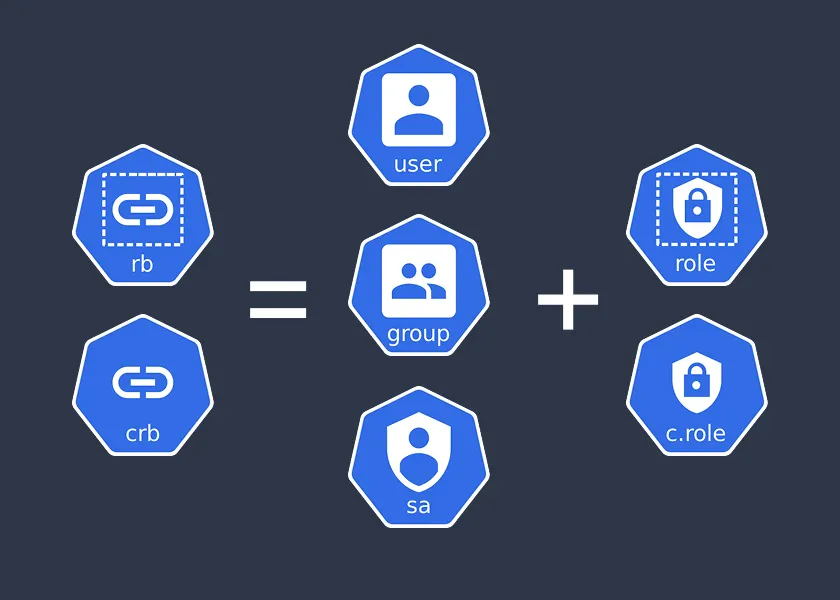

Role-Based Access Control (RBAC) in Kubernetes is a straightforward way to manage permissions. It controls who can access what resources in your cluster. Let’s break down the key components: Subjects, Roles, ClusterRoles, RoleBindings, and ClusterRoleBindings.



## Subjects: Who Gets Access

Subjects are the entities that need access to Kubernetes resources. They include:

- **Users**: Individual people, like developers or admins, interacting with the cluster.
- **Groups**: Collections of users, useful for assigning permissions to multiple people at once.
- **Service Accounts**: Special accounts for applications or processes running inside the cluster.

Why it matters: Subjects define who or what is requesting access, so you can grant permissions to the right entities.

## Roles and ClusterRoles: Defining Permissions

A Role specifies what actions (like get, create, or delete) can be performed on specific resources (like pods or deployments) within a single namespace. For cluster-wide control, use a ClusterRole, which applies to resources across all namespaces or cluster-level objects like nodes and persistent volumes.

Why it matters: Roles are namespace-scoped, while ClusterRoles provide broader control for cluster-wide resources or cross-namespace access. Use Roles for specific projects and ClusterRoles for global management tasks.

```yaml
apiVersion: rbac.authorization.k8s.io/v1
kind: Role
metadata:
  namespace: default
  name: pod-reader
rules:

- apiGroups: [""]
  resources: ["pods"]
  verbs: ["get", "list"]
```

This example Role allows getting and listing pods in the default namespace.

```yaml
apiVersion: rbac.authorization.k8s.io/v1
kind: ClusterRole
metadata:
  name: node-reader
rules:

- apiGroups: [""]
  resources: ["nodes"]
  verbs: ["get", "list"]
```

This example ClusterRole allows getting and listing nodes across the entire cluster.

## RoleBindings and ClusterRoleBindings: Connecting Subjects to Roles

A RoleBinding links a Subject to a Role, granting the permissions defined in the Role to that Subject within a specific namespace. For cluster-wide permissions, use a ClusterRoleBinding, which connects a Subject to a ClusterRole, applying permissions across all namespaces or to cluster-level resources.

Why it matters: RoleBindings are for namespace-specific access, while ClusterRoleBindings enable broader access control. Use ClusterRoleBindings when Subjects need to manage cluster-wide resources like nodes.

```yaml
apiVersion: rbac.authorization.k8s.io/v1
kind: RoleBinding
metadata:
  name: read-pods-binding
  namespace: default
subjects:

- kind: User
  name: jane
  apiGroup: rbac.authorization.k8s.io
roleRef:
  kind: Role
  name: pod-reader
  apiGroup: rbac.authorization.k8s.io
```

This RoleBinding lets the user jane use the pod-reader Role to access pods in the default namespace.

```yaml
apiVersion: rbac.authorization.k8s.io/v1
kind: ClusterRoleBinding
metadata:
  name: read-nodes-binding
subjects:

- kind: User
  name: jane
  apiGroup: rbac.authorization.k8s.io
roleRef:
  kind: ClusterRole
  name: node-reader
  apiGroup: rbac.authorization.k8s.io
```

This ClusterRoleBinding lets the user jane use the node-reader ClusterRole to access nodes cluster-wide.

## Key Takeaways

- Subjects (Users, Groups, Service Accounts) are who needs access.
- Roles (namespace-scoped) and ClusterRoles (cluster-wide) define what actions are allowed on which resources.
- RoleBindings (namespace-scoped) and ClusterRoleBindings (cluster-wide) connect Subjects to Roles or ClusterRoles.

By combining these, RBAC ensures secure and granular control over your Kubernetes cluster. Start with Roles and RoleBindings for namespace-specific tasks, and use ClusterRoles and ClusterRoleBindings for broader, cluster-wide management.
